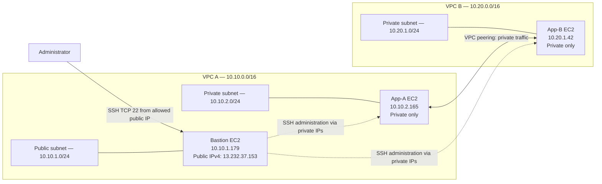

# AWS VPC Peering Project

### Connecting Two Private Networks Using AWS VPC Peering

**Author:** Raj Patil  
**Batch:** AWS Internship Batch1  
**AWS Region:** Asia Pacific (Mumbai), `ap-south-1`

This project demonstrates private IPv4 communication between two Amazon VPCs using VPC peering, EC2 instances, route tables, security groups, and a bastion host.

## Objectives

- Build two VPCs with non-overlapping CIDR ranges.
- Keep both application instances on private IPv4 addresses without public IPv4 addresses.
- Configure VPC peering and routes in both directions.
- Use a bastion host for administrative SSH access.
- Validate forward and reverse private-IP connectivity.
- Document the configuration, evidence, and cleanup process.

## Architecture

The administrator connects to the bastion host. App-A and App-B communicate using private IP addresses over the active VPC peering connection. The application instances are intended to have no public IPv4 addresses.

## Network inventory

| Resource | Name | CIDR / address | Resource ID |
|---|---|---|---|
| VPC A | `ewb-vpc-a` | `10.10.0.0/16` | `vpc-069ab77a8167915a5` |
| VPC B | `ewb-vpc-b` | `10.20.0.0/16` | `vpc-0cac7153b279dc807` |
| Public subnet A | `ewb-a-public` | `10.10.1.0/24` | `subnet-0449d69d8404dddbf` |
| Private subnet A | `ewb-a-private` | `10.10.2.0/24` | `subnet-01c558669ecd54a5d` |
| Private subnet B | `ewb-b-private` | `10.20.1.0/24` | `subnet-0d4ac455f97381f5` |
| Internet gateway | `ewb-igw-a` | Attached to VPC A | `igw-0508230ad22b0724f` |
| VPC peering | `ewb-a-b-peer` | Active | `pcx-086d9f1f868e17c94` |
| Bastion EC2 | `ewb-bastion` | Private `10.10.1.179`; public `13.232.37.153` | — |
| App-A EC2 | `ewb-app-a` | Private `10.10.2.165` | — |
| App-B EC2 | `ewb-app-b` | Private `10.20.1.42` | — |

## Route tables

| Route table | Subnet association | Required routes |
|---|---|---|
| `ewb-rt-a-public` | Public subnet A | `10.10.0.0/16 → local`; `0.0.0.0/0 → Internet Gateway`; `10.20.0.0/16 → VPC peering` |
| `ewb-rt-a-private` | Private subnet A | `10.10.0.0/16 → local`; `10.20.0.0/16 → VPC peering` |
| `ewb-rt-b-private` (`rtb-0e423296f55a2b12f`) | Private subnet B | `10.20.0.0/16 → local`; `10.10.0.0/16 → VPC peering` |

## Security design

- Bastion SSH ingress: TCP port 22 restricted to the administrator's public IP in CIDR `/32`.
- App-A and App-B SSH ingress: TCP port 22 allowed from bastion private IP `10.10.1.179/32`.
- ICMP Echo Request between application instances is restricted to the peer application's private IP.
- Use private IPs for cross-VPC tests.
- Never commit private keys, credentials, tokens, or local secret files.

## Validation results

The following results have been reported during the lab:

| Test | Result |
|---|---|
| App-A → App-B: `ping -c 4 10.20.1.42` | 4 packets transmitted, 4 received, 0% packet loss |
| App-B → App-A: `ping -c 4 10.10.2.165` | 4 packets transmitted, 4 received, 0% packet loss |
| SSH access to application instances via bastion | Confirmed by user; add clearly labelled screenshots to the evidence folder |

A baseline failure before peering and screenshot evidence of the controlled ICMP failure/recovery and final cleanup have not been documented in the available evidence. Do not treat those steps as evidenced until screenshots or records are added.

## Repository contents

- `docs/` — architecture, inventory, testing notes, troubleshooting, and cleanup checklist.
- `evidence/` — place labelled screenshots here; do not add private keys or credentials.
- The final internship report should be added after verifying its contents and updating any remaining placeholders.

## Cleanup reminder

To avoid ongoing AWS charges, verify and remove lab resources when finished: terminate EC2 instances, check attached EBS volumes and snapshots, release any allocated Elastic IP, remove peering routes and the peering connection, delete security groups after dependent network interfaces are gone, delete custom subnets and route tables, detach/delete the internet gateway, and finally delete both VPCs. Verify the lab resources are gone in the Mumbai region.

## Current status

**Core connectivity tests: reported successful. Documentation and evidence packaging: in progress.**

See [the docs folder](docs/) for the detailed inventory and test/cleanup notes.
